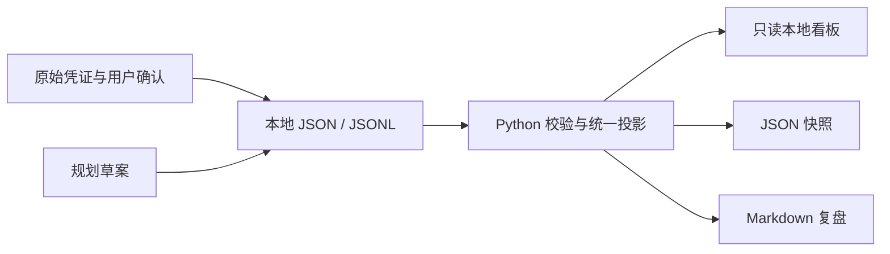

# 架构与扩展

公开版采用原系统的几项设计原则：权威文件与派生结果分离、事实与计划分离、事件追加与显式更正、发生时间与记录时间分离、缺失数据不填零。为避免个人规则隐藏在代码和测试中，运行核心、界面、测试及示例均重新构建，没有复制原私有项目目录或历史。

`wealthos/core.py` 是唯一资产、现金流和规划投影。`wealthos/__main__.py` 提供 CLI 和本机只读 HTTP 服务。`web/` 不依赖框架或 CDN，直接呈现 `/api/snapshot`。独立情景计算器仅计算用户输入的假设，不修改投影或账本。

浏览器没有文件写入权限，没有交易 API。HTTP 服务只绑定 127.0.0.1，校验 Host，拒绝任意文件路径，不提供跨域许可。它适合单用户本地使用；不应直接改为 0.0.0.0 后暴露公网。它也不是对本机其他恶意程序的隔离系统。

写入事件使用排他锁、校验后追加、flush/fsync；JSON 输出采用临时文件替换。锁遇到异常退出可能残留：先确认没有写入进程，再人工移除 data 目录中的 `.write.lock`。profile、opening、prices、plan 的人工编辑须在没有并发写入时进行；当前不是多用户事务数据库。

## 推荐扩展顺序

1. **账单导入**：新增适配器，先输出私有候选事件；用户核对后通过 add-event 导入。保留原始单据，增加幂等与多行凭证测试。
2. **公开行情**：独立采集器写 prices，记录来源、原始价格时间与获取时间。报价失败保留旧价并提示，不拿抓取时间冒充净值时间。不要把交易账户凭证加进公开数据配置。
3. **历史和收益**：追加价格历史、双时间账本查询、成本批次、外部现金流边界，再实现收益算法。当前快照不等于收益曲线。
4. **规划能力**：预算分桶、目标优先级、债务利息和通胀情景。每项假设需可编辑且明确展示。
5. **云端和定时任务**：先设计鉴权、密钥管理、私有存储、备份、访问控制和通知授权。把事实计算与模型生成文本保持分离，复用一条导出链。

暂未实现这些扩展。需要时把对应需求与 prompts/04-extend.md 交给模型；先写独立样例和可验收行为，再接真实资料。
